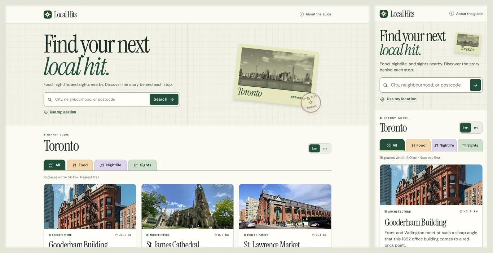

# Local Hits

A client-side neighbourhood field guide for food, nightlife and sights. It opens immediately with 15 edited Toronto entries. Search a city, landmark, neighbourhood or postcode, or use device location to explore elsewhere.



## Develop

Use Node 24 and npm.

```sh
npm ci
npm run dev
```

`npm test` runs the distance, classification and catalogue regression tests. `npm run build` type-checks the project and writes a production site to `dist/`. Use `npm run preview` to inspect the build.

## Cloudflare Pages

Connect this repository to a Pages project. Set the build command to `npm run build`, output directory to `dist`, and Node version to 24. Use the repository root as the build root. The site needs no Worker, database, secrets or runtime packages. Geolocation requires HTTPS or localhost.

## How nearby discovery works

- The opening Toronto edition is static. Its distances are measured from Berczy Park. Each entry in `src/toronto.json` has coordinates, an article, category tags, a short explanation and a field note.
- Place search uses Photon and OpenStreetMap. Searches are submitted explicitly. The browser asks for location permission only after the visitor presses the location button.
- An area search asks English Wikipedia for up to 60 geocoded pages within 5 km, then fetches introductions in batches of 20. Each batch becomes available as it arrives. Results are merged by article, with Toronto editorial entries taking precedence.
- Live categories are inferred from the article title, short description and introduction. Unclassified pages remain under All. Former venues with evidence of a surviving landmark appear under Sights. Coverage and venue status depend on the source article.
- Visitors can switch tabs instantly. Distances are straight-line measurements with a country-based default unit and a manual override. Raw device coordinates and searches are used for lookup and are not persisted by the app.
- The public lookup services can be slow or unavailable. Existing entries stay usable and visitors can retry failed Wikipedia lookups.

[Follow-up on restaurants mentioned inside other articles](https://github.com/arnavp103/local-hits/issues/1)

## Sources

Inspired by [Ed Jefferson’s Localpedia](https://edjefferson.com/localpedia/). Wikipedia extracts retain their article attribution and [CC BY-SA licence](https://creativecommons.org/licenses/by-sa/4.0/). Individual photograph credits and licences are available in the guide and in `src/credits.json`. Local WOFF2 fonts include their SIL Open Font Licences in `public/fonts/`. The repository MIT licence applies to the application code.
